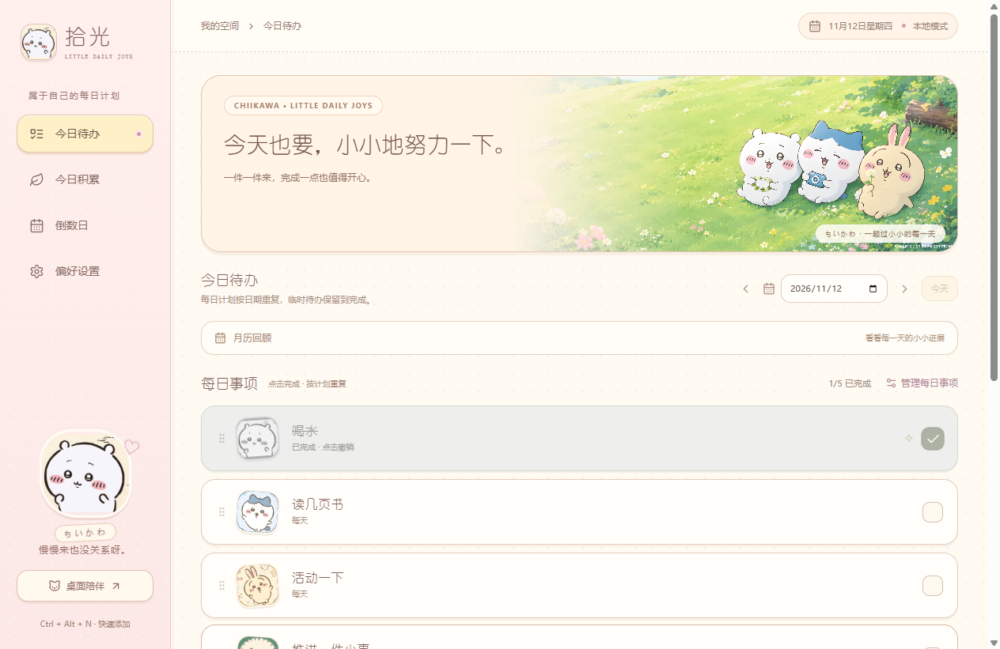
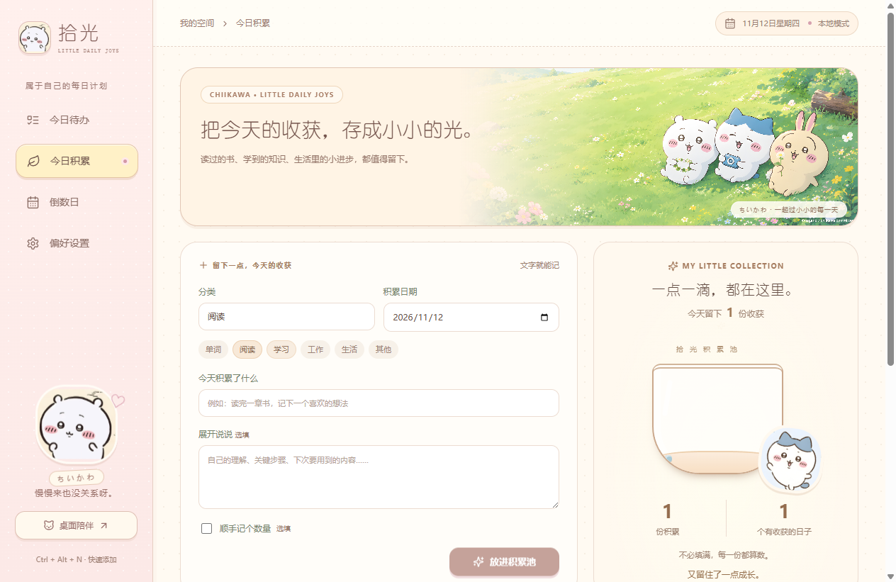
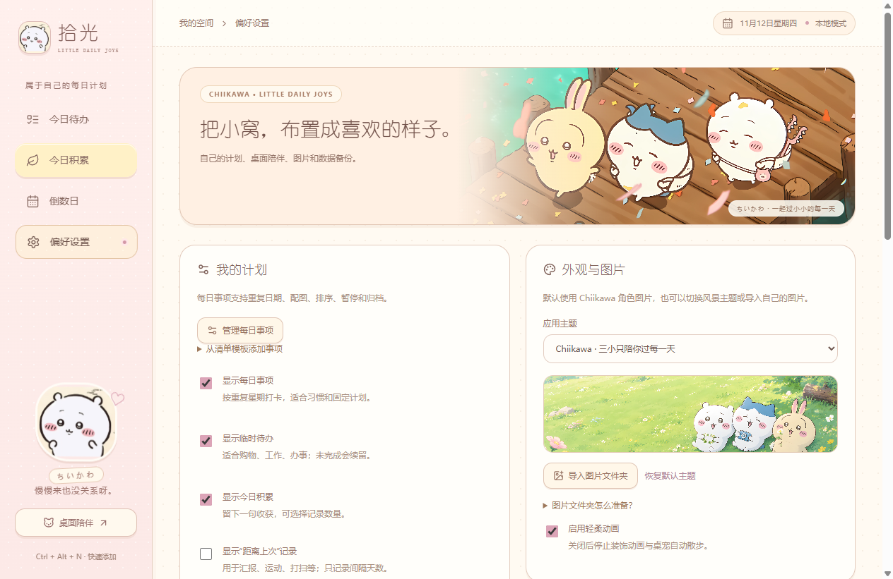

# 拾光 Shiguang · Chiikawa 每日陪伴

**把要做的事记下来，把已经做到的事留住。**

拾光是一款 Windows 桌面清单应用，带着 Chiikawa 主题和小八桌宠，陪你处理日常、安排学习与工作、记下一点收获。无需账号，日常使用无需联网。

你可以只用待办，也可以开启积累池、倒数日、间隔记录或背景音。**不需要的功能，都可以在偏好设置关闭。**

[下载最新版本](https://github.com/TXYhusband/shiguang/releases/latest) · [反馈问题](https://github.com/TXYhusband/shiguang/issues) · [参与开发](CONTRIBUTING.md)



## 下载与开始使用

前往 [Releases](https://github.com/TXYhusband/shiguang/releases/latest)，下载适合自己的文件：

| 文件 | 适合谁 | 怎么用 |
| --- | --- | --- |
| `StudyCompanion-0.4.0-portable.exe` | 想直接使用、放在 D 盘或 U 盘的人 | 放进自己的可写文件夹，双击打开 |
| `StudyCompanion-0.4.0-setup.exe` | 希望安装并创建快捷方式的人 | 运行安装器，可以选择安装目录 |
| `StudyCompanion-0.4.0-source.zip` | 想修改代码或自己构建的人 | 解压后按下方开发说明操作 |

目前提供 Windows x64 版本，建议 Windows 10 / 11。发布包尚未做代码签名；macOS 与 Linux 暂未验证。

第一次打开，可以先用日常生活清单，再选择学习成长、工作安排或科研求职模板。事项都能改名、换图、选择重复星期和调整顺序。

## 可以拿来做什么

| 功能 | 例子 | 使用方式 |
| --- | --- | --- |
| 每日事项 | 阅读、散步、喝水、复习、下班前收尾 | 点一下完成；按设定的星期重复出现 |
| 临时待办 | 买东西、准备材料、处理一个工作任务 | 未完成的事项会继续保留，也能备注、设截止日期和重要标记 |
| 今日积累 | 读书想法、学到的知识、生活进步、项目收获 | 写一句话或一段笔记，可选填数量和单位 |
| 倒数日 | 生日、旅行、考试、提交日期 | 显示还有多少天，可自行开启桌面提醒 |
| 间隔记录 | 给植物浇水、打扫、联系家人、汇报进展 | 记录上一次完成日期，看看已经过去多久；名称可修改 |
| 桌面陪伴 | 小八在桌面陪你 | 可以摸摸、喂食、玩球、睡觉，或开启自由散步 |
| 背景音 | 阅读或工作时的环境音 | 内置柔和环境音，也可选择自己的本地音乐 |

### 每日事项和临时待办有什么区别？

**每日事项**适合固定习惯。比如“周一到周五阅读”，按重复星期出现，新的一天重新打卡；过去的完成情况可在月历查看。

**临时待办**适合一次性的事情。今天没做完，明天仍然看得见。完成后变灰，可以编辑、归档、移到其他日期，或转成每日事项。

按住每日事项卡片上下拖动可排序；在“管理每日事项”中也能用上下箭头调整。模板会追加事项并跳过已有同名项，不覆盖现有清单和历史记录。

### 用积累池留下收获

可以写“今天终于弄懂了一个概念”，也可以记录“读了 10 页书”“复习了 30 个单词”。数量是可选的，不同分类与单位分别汇总。

每次成功保存，会有一颗小光点落入积累池。可以查看今天或全部积累，搜索内容、筛选分类、补记过去日期，也能修改或确认删除。关闭界面动画、或系统选择减少动态效果时，积累池使用静态呈现。



### 按自己的习惯布置

偏好设置可以分别开关每日事项、临时待办、今日积累、间隔记录、倒数日、背景音、桌宠和动画。**关闭模块不会删除已有记录，重新开启即可继续使用。**

新用户的间隔记录默认关闭；需要时再开启，并改成自己的名称。默认内置 Chiikawa 主题，也能切换原创风景主题或导入本地图片。



## 常用操作

- `Ctrl + Alt + N`：应用运行时，快速打开临时待办输入框；临时待办关闭时会提示先开启。
- 关闭主窗口：应用留在系统托盘。要完全退出，右键托盘图标，选择“退出拾光”。
- 倒数日通知：需开启对应事件提醒，且应用保持运行；隐藏倒数日模块会暂停通知。
- 升级：先在设置导出 JSON 备份。便携版替换 EXE 时保留同目录的 `data` 和 `study-profile.json`。

## 我的数据在哪里？

| 使用方式 | 默认位置 |
| --- | --- |
| 便携版 / 解压运行 | EXE 同级的 `data` 文件夹 |
| 安装版 | `%APPDATA%\StudyCompanion\data`，与程序安装目录分开 |

偏好设置中的“打开数据目录”能找到实际位置。“迁移数据目录”可迁到其他磁盘的空文件夹，会先备份、复制校验并重启，原目录保留。

数据保存在本地 SQLite，JSON 备份包含清单、打卡、积累、间隔记录、倒数日和设置。自动保留最近 30 份日常备份；恢复和迁移前的保护备份另存。自己导入的图片需另行携带，选择本地音乐不会把音频加入 JSON 备份。

没有账号、云同步、广告或遥测。更换电脑可以手动导出与恢复备份。详见 [隐私说明](PRIVACY.md)。

## 用 Agent 定制自己的拾光

你可以把这份项目交给编程 Agent，继续改成自己喜欢的样子：调整配色和布局、增加新功能、简化页面，或者换一套日常清单。

1. Fork 仓库，或在 [Releases](https://github.com/TXYhusband/shiguang/releases/latest) 下载名称以 `-source.zip` 结尾的**源码包**。
2. 解压源码包，让支持本地项目的编程 Agent 打开这个目录；如果 Agent 支持上传项目包，也可以直接上传源码 ZIP。便携 EXE 和安装器用于运行软件，定制开发请使用源码。
3. 描述想改的效果，可以附上界面参考图。完成后让 Agent 构建并测试，再生成你自己的 Windows 版本。

下面这段提示词可以直接复制，把最后的需求换成自己的：

```text
请基于这份「拾光 Shiguang」源码，帮我定制一个自己使用的版本。

先阅读 README.md、CONTRIBUTING.md 和 package.json，了解 Electron、React、TypeScript、Vite 和 SQLite 的现有实现，再说明修改方案并完成开发。

要求：
- 默认保留 Chiikawa 主题；配色、排版或图片的改动按我下面的需求处理。
- 保留已有清单、积累、倒数日等数据的兼容性，不重置个人记录。
- 新增功能尽量能在偏好设置里开关，界面文案让普通用户也能看懂。
- 开发测试使用项目 .cache 下的独立数据目录，通过 STUDY_DATA_DIR 指定。
- 完成后运行相关测试和 npm run build，检查实际界面，并用 npm run package:release 生成 Windows 便携版与安装版。
- 告诉我改了什么、怎么使用，以及生成的文件在哪里。

我的定制需求：
[在这里写希望增加、删除或调整的功能，以及喜欢的界面风格。]
```

可以这样补充需求：“只保留每日待办、积累池和倒数日，首页做得更简洁”“把整个页面改成我喜欢的奶油蓝配色”“增加一个可以关闭的每周回顾页面”。

定制前先导出个人数据备份。分享给 Agent 或其他人的是源码项目，个人 `data` 文件夹、备份、`study-profile.json` 和额外导入的私人图片请另行保管。

## 开发与构建

使用 **Node.js 24、npm 和 Windows**。本地开发、测试缓存放在项目 `.cache`；测试使用独立数据目录，不连接日常使用的数据。

```powershell
npm ci
npm test
npm run build
npm start

# Windows 发布包：便携 EXE + 可选目录安装器
npm run package:release

# 导出源码，并在解压后的独立副本中安装依赖、测试和构建
npm run source:verify
```

`npm run dev` 仅提供前端预览，文件操作与数据保存需在 Electron 中使用。`STUDY_DATA_DIR` 可指定独立数据目录。

```powershell
node tests/public-v04-desktop.cjs
node tests/accumulation-desktop.cjs
node tests/custom-planner-desktop.cjs
node tests/theme-default-desktop.cjs
```

设置 `STUDY_PACKAGED=1` 可让上述桌面测试检查 `release/win-unpacked` 中的程序。`node tests/portable-desktop.cjs` 检查实际便携启动器。GitHub Actions 会构建 Windows 包并运行桌面回归。

技术栈：Electron、React、TypeScript、Vite、SQLite。所有日常功能都在本地工作，无需 API 密钥。

## 反馈与贡献

欢迎在 [Issues](https://github.com/TXYhusband/shiguang/issues) 提交问题或想法。遇到问题时，说明版本、Windows 版本、操作步骤和预期结果；截图请遮掉自己的个人内容，无需上传数据库或备份。

PR 请参照 [贡献说明](CONTRIBUTING.md)。新增功能优先考虑可选开关、离线使用和旧数据兼容。

## 许可与素材

软件原创代码和原创风景/动物素材采用 [MIT License](LICENSE)。这是**非官方 Chiikawa 主题项目**；Chiikawa 角色、图片及其衍生图形归原权利人所有，不属于 MIT 授权。素材来源与独立权属说明见 [chiikawa/NOTICE.md](chiikawa/NOTICE.md)。

桌宠的部分活动逻辑改编自 MIT 许可的 VS Code Pets，说明见 [THIRD_PARTY_NOTICES.md](THIRD_PARTY_NOTICES.md)。

---

**English:** Shiguang is a local-first Windows daily planner with a Chiikawa theme and desktop companion. It includes recurring checklists, one-off tasks, an accumulation journal, countdowns and optional interval records. Modules can be disabled individually. No account or API key is needed. Original code is MIT-licensed; character artwork has separate rights notices.
